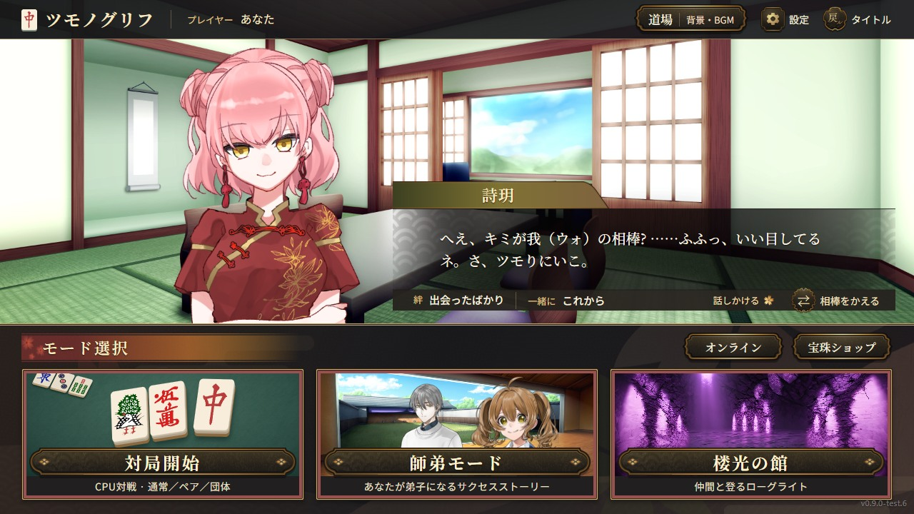

# 相棒ホーム（2026-11-27）

タイトルで「はじめる」を押すと、相棒が選択中の場所で出迎える。画面上段を横長の一場面に使い、下段に三つの遊びを選ぶ絵札を並べた。

## 相棒と過ごす場所

- 背景を設定したことがない場合は道場で始まる。青海波や街角、ショップで解禁した場所を選ぶと相棒の背後の風景が替わる。「背景・BGM」の一覧は右側に開き、相棒を見ながら選べる。
- 名前、セリフ、操作の順に、購入素材のメッセージ窓の三段を使う。人物と会話窓のどちらをタップしても相棒が返事をする。下帯には絆、共闘局数、「相棒をかえる」を置いた。
- 人物には既存の立ち絵とキャラ別の `imagePos.home` を使う。見出しとセリフは Noto Serif JP、操作と補足は Noto Sans JP。フォントは対局画面と共用する。

## 遊びの入口

| 絵札 | 画面に出る内容 |
| --- | --- |
| 対局開始 | 卓布と実際の捨て牌・手牌。通常、ペア、団体のCPU対戦を選べる。 |
| 師弟モード | 弓道場と弟子の立ち絵アイコン。育成中の弟子がいれば、その弟子と師匠の顔、弟子の名前を表示する。 |
| 楼光の館 | 紫の光が差す迷宮。到達記録があれば最深階を表示する。 |

三枚に共通して、絵の外周に可変ウィンドウ、モード名に選択肢ボタンを重ねる。オンラインと宝珠ショップは絵札の上から直接開ける。

「相棒をかえる」では今の相棒がいるページから、名前・読み・能力・役割で次の雀士を探せる。[タイトルと各モードのキャラ選択設計](entry-and-roster.md)

## 空想曲線「ゲームUIセット vol.19」

豪華版同梱テーマ `theme_kopanda_bth_09` の `init.ks` と `html/menu.html` を参照した。会話窓は原画の上48pxが名前、中央144pxが本文、下36pxが操作帯。選択肢と長方形ボタンは左右の飾りを保って伸ばし、カーソル・キーボードフォーカス・押下に原本の状態差分を割り当てる。相棒変更は雪輪、設定・戻る・閉じるには専用図柄を使う。PNGは配布時のデータをHTMLとCSSから参照する。[作者の素材紹介](https://kopacurve.blog.fc2.com/blog-entry-669.html)／[素材利用規約](https://kopacurve.blog.fc2.com/?no=394)／[ゲームのクレジット](../CREDITS.md)

## 動作確認

- Chrome の一時プロフィールで、対局・師弟・楼光・ショップ・設定・タイトルへの移動と復帰、オンラインのログイン案内を開いて閉じる操作を確認した。
- 道場・街角・青海波の切替、解禁済みの喫茶店を保存した状態からの再表示、BGM、相棒変更を確認した。絆ゲージと連続選択の保存は確認用のプロフィールでも検証した。
- 1280×720、960×540、390×844の縦持ち回転表示で、操作の収まりとフォーカス復帰を確認した。全332件のホーム用セリフが名前や操作帯に重ならず本文欄に収まる。

ローカルで開くには `npm start` を実行して `http://localhost:5173/` の「はじめる」を選ぶ。
